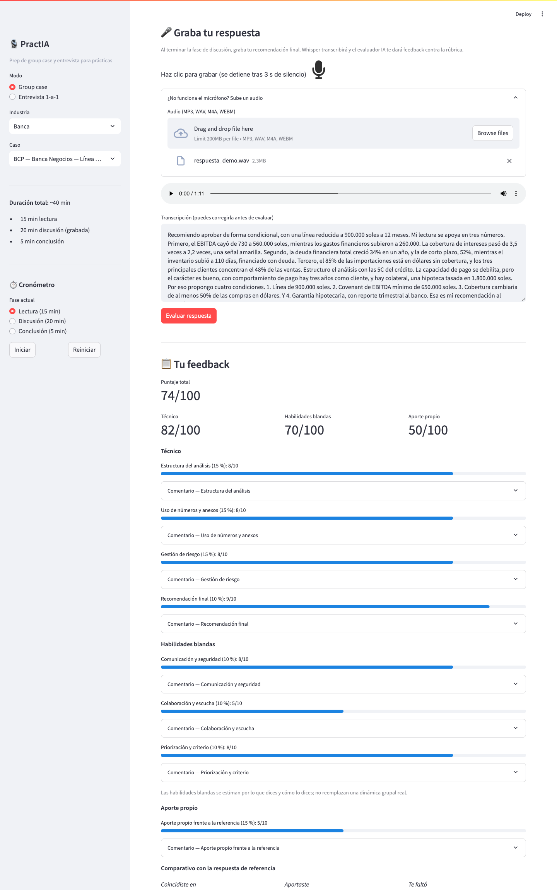
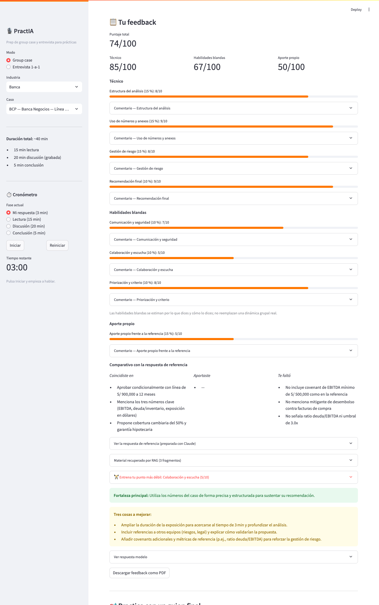
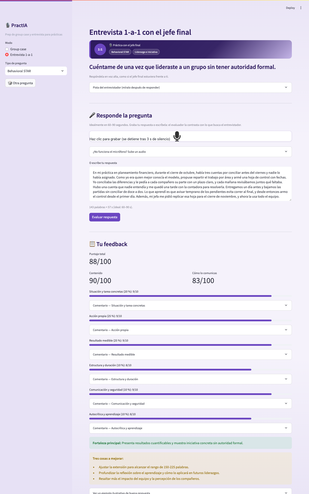
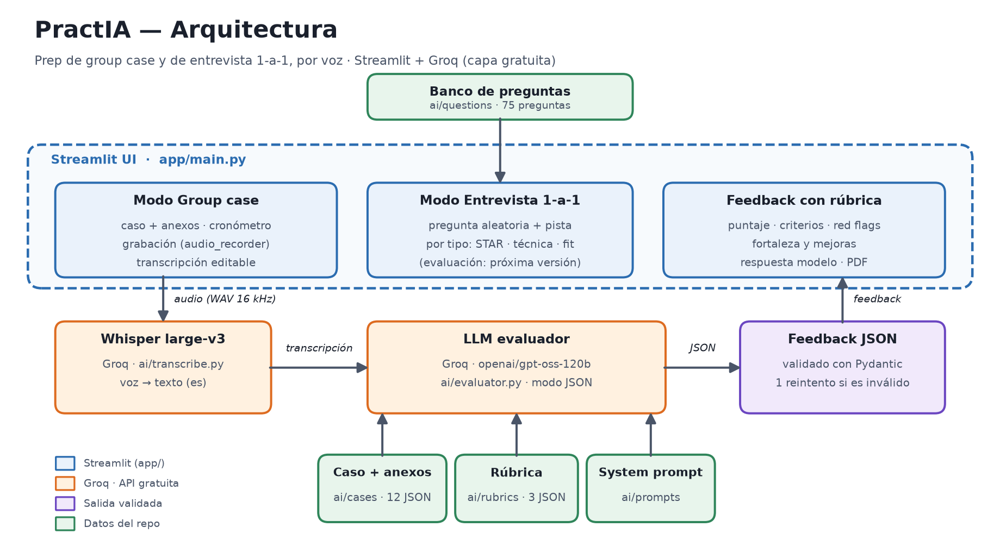

# PractIA

> Prep de **group case** y de **entrevista final** por voz para estudiantes peruanos que postulan a su primera o segunda práctica en banca, FMCG y consultoría. Dos módulos: un **simulador de group case** (caso con anexos, cronómetro y rúbrica) y una **entrevista individual con el jefe final** (preguntas reales del proceso peruano). En ambos hablas, y recibes feedback contra una rúbrica en menos de 1 minuto.

**One-liner:** Hacemos simulacros de group case y de entrevista final para estudiantes peruanos que postulan a prácticas y programas trainee, mediante voz (Whisper) y un evaluador con rúbrica (LLM con salida estructurada + RAG) sobre casos y preguntas del proceso peruano.

---

## 1. Founder

<!-- FOTO: guarda tu foto en docs/founder.jpg y reemplaza esta línea por:  -->

**Ana Renata "ReMar" Zuta Luyo** — estudiante de Economía en Universidad del Pacífico (10.º ciclo, graduación dic. 2026), tercio superior. Analista de Planeamiento Financiero en Lima Expresa (OPEX, control presupuestal). Internship previo en Crece Finanzas Estratégicas (crédito privado, modelado financiero, riesgo SME). Preparando CFA Nivel I.

**Por qué soy la persona indicada:** soy postulante activa a programas de prácticas (Interbank, Nexa Resources, Repsol), así que vivo el problema en primera persona. Y vengo de finanzas: pude escribir yo misma las rúbricas y revisar las cifras de los casos de banca (crédito PYME, pricing, portafolio), que es donde un simulador genérico falla.

**Cómo cubro producto, ingeniería, diseño y ventas con agentes de IA** (una sola persona, sin equipo):

| Función | Qué hago yo | Qué hace el agente (Claude Code) |
|---|---|---|
| **Producto** | Elijo el problema, las empresas objetivo y la rúbrica (55 % técnico / 30 % habilidades blandas / 15 % aporte propio, que salió de las 3 entrevistas); decido qué entra al banco de preguntas. | Redacta borradores de casos, anexos y pistas; yo los reviso. El 12-nov hice con el agente una auditoría de cifras: se corrigieron 10 incongruencias entre anexos y respuestas de referencia en 8 casos (commit `384710b`). |
| **Ingeniería** | Defino requisitos, pruebo con la API real y despliego. | Escribe la mayor parte del código (app, evaluador, RAG, PDF). Ver sección 9. |
| **Diseño** | Elijo identidad por empresa (colores inspirados en la marca, sin logos). | Genera el tema y el CSS (`app/theme.py`) y una prueba de contraste WCAG AA. |
| **Ventas** | Hice las 3 entrevistas de validación y las transcribí con Whisper. Aún no vendo: primero valido (ver sección 7). | Preparó conmigo la guía y los mensajes de contacto (`docs/PractIA_Guia_Entrevistas.pdf`) y sintetizó las transcripciones. |

## 2. Problema

**Quién lo sufre:** estudiantes de los últimos ciclos (y recién egresados) de Economía, Administración e Ingeniería Industrial en Lima que postulan a su primera o segunda práctica, o a programas trainee, de banca, consumo masivo y consultoría. Enfrentan dos pruebas para las que no pueden prepararse solos:

1. **El group case:** por definición requiere 4–6 personas, caso impreso, cronómetro y un evaluador.
2. **La entrevista final con el jefe:** la ronda individual (1-on-1 en Credicorp Capital, jefe directo en Belcorp, entrevistas conductuales en P&G) mezcla preguntas comportamentales (STAR), técnicas de la industria y de fit con la empresa. Para practicarla hace falta saber qué preguntan de verdad y recibir feedback honesto sobre cómo suena tu respuesta.

**Cuánto les cuesta y cómo lo resuelven hoy sin PractIA:**

| Alternativa hoy | Límite |
|---|---|
| Grupos de WhatsApp improvisados | Cuesta cuadrar horarios; no hay quien conozca el proceso. Una persona entrevistada buscó a alguien que ya hubiera pasado por la dinámica y "eso fue imposible". |
| Consejos informales de compañeros | Gratis, pero anecdóticos: sin práctica ni feedback sobre cómo suena tu respuesta. |
| Coaching individual o plataformas tipo Preplounge (rango referencial **S/ 150–500** por sesión) | Caro y no replica el proceso peruano. Otra persona pagó un programa que simulaba la dinámica (no dijo el monto). |
| Material de la universidad | Sirve para lo técnico (una persona dedicó 2–3 h por semana), no para hablar bajo presión. |
| ChatGPT genérico | No conoce el contexto peruano ni lo que preguntan estas empresas. |
| No hacer nada | Llegar sin un "speech armado" a una prueba que define el pase a la siguiente ronda. |

El costo que más pesa no es el dinero sino el de no pasar de ronda: la tercera fase es la más temida porque "hay más probabilidades de quedar, pero también hay más probabilidades de que no quedes".

**Evidencia — 3 conversaciones con usuarios potenciales** (notas completas con citas literales en `docs/research/`; iniciales por privacidad, los audios no están en el repo):

| Entrevista | Perfil | Qué confirmó | Qué cambié en el producto |
|---|---|---|---|
| [01 · Banca](docs/research/entrevista-01.md) | H., auditoría de riesgos de banca mayorista; pasó por las 3 fases de un proceso bancario | Su mayor miedo fue la entrevista final con gerentes, no el group case. Se preparó solo con consejos de compañeros. | Priorizar el Módulo 2; caso `banca_04` (pricing); criterio «Colaboración y escucha»; pregunta STAR sobre errores propios. |
| [02 · FMCG](docs/research/entrevista-02.md) | M., trainee de finanzas comerciales en consumo masivo | Le faltó saber qué preguntas de habilidades blandas piden; pagó un programa para simular la dinámica. | Banco de preguntas con pista de evaluación; preguntas trampa; criterio «Priorización y criterio». |
| [03 · Consultoría](docs/research/entrevista-03.md) | C., practicante en su segunda práctica | **Confirmación parcial:** con base econométrica no partía de cero; el dolor es la seguridad y los nervios al responder. | Caso `consultoria_04` (evaluación de impacto); preguntas de fit; feedback antes del intento. |

**Lo que las entrevistas no confirmaron** (y por eso lo trato como hipótesis): el dolor es menor en perfiles con base técnica, y la disposición a pagar es baja o no está medida (de 3, una persona pagó un programa; las otras dos casi no gastaron). Las tres se hicieron en noviembre de 2026; la fecha exacta y el canal no quedaron registrados en el audio.

## 3. Solución

**PractIA** es una app web con dos módulos que cubren las dos pruebas donde se define una práctica. Comparten el selector de empresa, la transcripción por voz y el evaluador IA contra rúbrica.

### Módulo 1 — Simulador de group case

1. Elige empresa objetivo (BCP, Alicorp, Apoyo Consultoría, etc.) y tipo de case.
2. Recibe el caso: 1 página de contexto + anexos numéricos (sintéticos pero realistas).
3. Cronómetro con cuenta regresiva que corre solo: fases estándar (lectura 15 min → discusión 20 min → conclusión 5 min) y una de 3 min para tu respuesta, con aviso al excederte.
4. Resuelve por voz; Whisper transcribe en segundos y puedes corregir el texto antes de evaluar.
5. El evaluador IA puntúa contra una rúbrica por industria con tres tipos de criterio: **técnicos (55 %)**, **habilidades blandas (30 %)** (comunicación y seguridad, colaboración y escucha, priorización) y **aporte propio (15 %)**, que compara tu respuesta con una respuesta de referencia del caso preparada con Claude. Devuelve el puntaje total y por tipo, el comparativo con la referencia (en qué coincidiste, qué aportaste y qué te faltó) y red flags. Las habilidades blandas se estiman por lo que dices y no reemplazan una dinámica grupal real. Se puede descargar en PDF.
6. Un botón arma un **guion final** de ~3 minutos que combina tu respuesta con el contraste de la IA (lo que te faltó, lo que aportaste, tus puntos a mejorar) y lo baja en **un solo PDF** para practicar: guion con tiempos por bloque, qué cambió, contraste con la referencia y tu respuesta original.

**Identidad por empresa y extras de práctica:** cada caso se pinta con los colores y el monograma de su empresa (franja con tipo de caso, duración y anexos, y la tarjeta "Tu misión" con lo que se evalúa); un **recorrido guiado** (Leer → Responder → Evaluar → Guion final) marca en qué paso vas; el **historial de intentos** muestra la diferencia frente al intento anterior y un gráfico de progreso; y **"Entrena tu punto más débil"** usa el RAG para recomendarte preguntas reales del banco según tu criterio más bajo. Los colores están inspirados en cada marca (sin logos) y cumplen contraste de accesibilidad WCAG AA.

### Módulo 2 — Prep de entrevista individual con el jefe final

El **jefe final** es el gerente o jefe del área que cierra el proceso. PractIA lo simula:

1. Elige el tipo de pregunta en la barra lateral (Behavioral STAR, técnica de banca, FMCG o consultoría, o Fit) y el banco te da una al azar; puedes pedir otra.
2. El jefe final te la hace; la pregunta sale del banco `docs/PractIA_Banco_Preguntas.pdf` y se muestra en pantalla (leerla en voz alta con TTS queda como ampliación).
3. Respondes por voz, subes un audio o escribes; Whisper transcribe y puedes corregir el texto.
4. El evaluador IA devuelve feedback según el eje de la pregunta (`ai/interview_evaluator.py`, rúbricas en `ai/rubrics/entrevista.json`):

| Eje | Qué evalúa |
|---|---|
| **Behavioral STAR** | ¿Están las 4 partes (Situación, Tarea, Acción, Resultado)? ¿Arranca con una situación concreta, habla en "yo" y no en "nosotros", y cierra con un resultado medible? ¿Cabe en 60–90 s? |
| **Técnica por industria** | Precisión del concepto o framework (EBITDA, 5Cs, 4Ps, MECE…), uso del contexto peruano y estructura del razonamiento. Banca, FMCG o consultoría según la empresa elegida. |
| **Fit** | Motivación específica (un número, una campaña, un reporte leído) en vez de genérica; conocimiento de la empresa; un diferencial concreto frente a otros postulantes. |
| **Perfil y criterio** | Para debilidades, preguntas trampa y de argumentación (que no son STAR ni de motivación): autoconocimiento con evidencia en vez de clichés, y un plan de mejora o un argumento concreto. |

Cada pregunta del banco trae su pista de evaluación (qué busca el entrevistador y qué es red flag: *"esperé a ver qué pasaba"*, *"no he tenido desacuerdos"*, *"soy muy perfeccionista"*), y el evaluador la usa como criterio. El feedback incluye el puntaje total y por tipo (contenido y cómo lo comunicas), cada criterio con su comentario, la fortaleza principal, tres cosas a mejorar, red flags y un ejemplo ilustrativo de buena respuesta. **El total lo calcula el código** con los pesos de la rúbrica, y **la duración también**: si la respuesta cae fuera de 45–120 s, el criterio de duración no pasa de 6/10 (en una prueba real el modelo dio 10/10 a una respuesta de 30 s).

**Corpus de preguntas** (75 en total: 60 del banco `docs/PractIA_Banco_Preguntas.pdf` y 15 que salieron de las entrevistas de validación; un JSON por tipo en `ai/questions/`, con `pregunta`, `hint`, `tipo`, `subtema` y `fuente`):

| Archivo | Preguntas | Subtemas |
|---|---|---|
| `behavioral_star.json` | 18 | Liderazgo e iniciativa · Trabajo en equipo y conflicto · Resolución de problemas y presión · Errores y comunicación · Escucha y humildad · Preguntas trampa |
| `fit.json` | 9 | Motivación y fit · Perfil personal · Criterio y argumentación |
| `tecnica_banca.json` | 17 | Fundamentos financieros · Contexto peruano · Casos y razonamiento · Pricing |
| `tecnica_fmcg.json` | 14 | Marca y marketing · Canal y trade · Consumer insight (el banco incluye el caso Marsella vs P&G) |
| `tecnica_consultoria.json` | 17 | Frameworks · Market sizing · Fit y motivación · Econometría y evaluación de impacto |

**Fuentes del corpus:** Glassdoor PE, Indeed PE, blog BCP, Perú Retail, Wharton Consulting Casebook 2025, PrepLounge, Management Consulted y Case in Point (referencia general, sin reproducir contenido), más las 3 entrevistas de validación (`docs/research/`). Detalle completo del banco en [`docs/PractIA_Banco_Preguntas.pdf`](docs/PractIA_Banco_Preguntas.pdf).

## 4. Insight

El mercado asume que practicar group case **requiere grupo**. Pero buena parte de lo que evalúan los reclutadores es el desempeño individual: cómo estructuras, cómo priorizas, cómo comunicas bajo presión. Eso **sí** se puede practicar solo si tienes el caso, el cronómetro y una rúbrica que refleje cómo evalúan las empresas peruanas.

Con la entrevista final pasa lo mismo: no necesitas a otra persona, necesitas **las preguntas reales del proceso peruano**, un lugar donde responder en voz alta y un evaluador que distinga una respuesta STAR de una anécdota sin resultado. Las dos pruebas se practican con la misma lógica: solo, por voz y con feedback contra un criterio explícito.

## 5. Why now

- **Whisper large-v3 sobre Groq** transcribe voz en español en segundos y con capa gratuita, sin tarjeta.
- **LLMs con salidas estructuradas** (modo JSON + validación Pydantic) permiten rúbricas confiables sin reglas rígidas, tanto para un group case como para una respuesta STAR.
- **Hay decenas de miles de estudiantes de pregrado de economía / admin / ing. industrial** en Lima postulando a prácticas cada ciclo *(estimación; por sustentar con datos de SUNEDU)*.

## 6. Demo

- **URL pública:** https://practia-up.streamlit.app/ (la app se duerme tras un rato sin visitas; la primera carga puede tardar unos segundos).
- **Probarlo en 2 minutos:** elige una empresa y un caso en la barra lateral → lee el caso y los anexos → graba tu respuesta (o sube un audio) → corrige la transcripción → *Evaluar respuesta* → revisa el puntaje por tipo de criterio, el comparativo con la referencia y descarga el PDF. Si el micrófono falla, usa «Usar la respuesta de referencia como ejemplo». El módulo **Entrevista 1-a-1** funciona igual: elige un tipo de pregunta, responde y evalúa. El plan gratuito de Groq permite una evaluación por minuto.
- **Video de respaldo (60–90 s):** _pendiente_ <!-- cuando lo grabes: reemplaza "_pendiente_" por el link -->
- **Código:** este repo; el flujo principal está en `app/main.py` → `ai/transcribe.py` → `ai/evaluator.py`.
- **Cómo correrlo en local:** ver [Cómo correrlo](#cómo-correrlo).

**Capturas del flujo principal (group case):**

| 1. Voz → transcripción editable → evaluación | 2. Feedback por rúbrica, comparativo y PDF | 3. Modo entrevista 1-a-1 |
|---|---|---|
|  |  |  |

**Arquitectura** (`docs/architecture/arquitectura.png`):



Modelos y APIs (todo sobre [Groq](https://console.groq.com), capa gratuita):
- **Whisper large-v3** → transcripción de la voz del estudiante, en ambos módulos.
- **openai/gpt-oss-120b** (modo JSON, configurable con `GROQ_LLM_MODEL`) → evaluador contra rúbrica, con salida validada con Pydantic: rúbricas por industria para el group case (`ai/evaluator.py`) y rúbricas por eje para la entrevista (`ai/interview_evaluator.py`).
- **RAG ligero** (BM25 en Python puro, `ai/rag.py`) → recupera del corpus (75 preguntas de entrevista con lo que busca el entrevistador y 12 casos con su respuesta de referencia) los fragmentos más parecidos al caso y a tu respuesta, y se los da al evaluador como material de apoyo; el feedback los muestra. *Ampliación por construir:* RAG con memorias anuales (BCP, Alicorp, Credicorp) y ChromaDB (`requirements-rag.txt`).

**Por qué estos modelos:** Groq ofrece Whisper large-v3 y un LLM abierto con salida JSON en una capa gratuita, sin tarjeta, y responde en segundos (una evaluación tarda unos 10 s), que es lo que necesita un simulacro por voz. La contra es el límite del plan gratuito (8K tokens por minuto y 200K por día): por eso la app muestra mensajes claros ante el límite, no repite evaluaciones idénticas y el costo por sesión se calculó con los precios de pago de Groq (sección 7). **Privacidad:** el audio y la transcripción se envían a Groq para procesarse; la app no los guarda (solo viven en la sesión del navegador) y el repo no contiene audios ni datos personales (las entrevistas de validación van con iniciales).

**Estado (nov. 2026):** *Módulo 1* — flujo de voz conectado (grabación → Whisper → transcripción editable → evaluador → feedback y PDF), evaluación por rúbrica v2 y un RAG ligero que le da material de apoyo al evaluador, probado de punta a punta con la API real de Groq (ver capturas); desplegado en Streamlit Cloud. *Módulo 2* — banco de 75 preguntas en `ai/questions/`; graba, sube un audio o escribe tu respuesta, Whisper la transcribe y el evaluador la puntúa contra la rúbrica de su eje (STAR, técnica, fit o perfil); probado con la API real. Ambos módulos tienen un plan B si falla el micrófono, mensajes claros ante los límites de Groq y 141 pruebas automáticas (`pytest`). Detalle en `CLAUDE.md`.

## 7. Modelo de negocio

| Plan | Precio | Qué incluye |
|---|---|---|
| Free | S/ 0 | 2 sesiones/mes (group case o entrevista), feedback básico |
| Pro | **S/ 29/mes** | Group cases y entrevistas ilimitados, feedback detallado (STAR + técnica + fit), biblioteca por empresa |
| Teams (universidades) | **S/ 500/mes** | 50 usuarios, dashboard del profesor, cases y preguntas personalizados |

**Margen de contribución por usuario Pro:** ~S/ 28/mes (costo API ~S/ 1 con 40 sesiones al mes). Una sesión cuesta ~S/ 0.03 a precios de Groq (gpt-oss-120b: US$ 0.15 / 0.60 por millón de tokens de entrada / salida; Whisper large-v3: US$ 0.111 por hora; tipo de cambio S/ 3.7; respuesta de 3 min y ~6K tokens por evaluación). Estimación sin comisiones de pasarela de pago; la capa gratuita de Groq no sirve para producción y se pasaría al plan Developer. Hoy el hosting cuesta S/ 0 (Streamlit Community Cloud).

**Qué falta validar:** quién paga. Las entrevistas mostraron baja disposición a pagar en estudiantes (ver sección 2), por eso el plan Teams (la universidad paga por sus alumnos) es la hipótesis a probar primero, y el plan Pro queda como segunda apuesta. Los precios son hipótesis, no resultados de mercado.

## 8. Herramientas del curso

Tres herramientas del syllabus están dentro del producto (no solo en el desarrollo), todas en archivos que existen hoy:

| Herramienta | Sesión | Dónde está en el repo | Por qué esa |
|---|---|---|---|
| **Whisper large-v3 (voz a texto)** | 13 | `ai/transcribe.py` (en la app, vía Groq); `scripts/transcribe_batch.py` (para transcribir las entrevistas de validación) | Las dos pruebas se rinden hablando: transcribir permite evaluar lo que dijiste y corregir el texto antes de evaluar. |
| **LLM con salidas estructuradas** | 8 | `ai/evaluator.py` y `ai/interview_evaluator.py` (JSON validado con Pydantic; el total lo calcula el código, no el modelo) y `ai/guion.py` (guion final); prompts en `ai/prompts/` | Una rúbrica solo sirve si el feedback es comparable entre intentos y empresas; el JSON validado lo garantiza. |
| **RAG** | 8 | `ai/rag.py` (BM25 en Python puro), usado por `ai/evaluator.py` y por el botón "Entrena tu punto más débil" en `app/main.py` | El corpus es pequeño (87 documentos), así que BM25 no necesita dependencias pesadas y cabe en el plan gratuito de Streamlit Cloud. ChromaDB con memorias anuales queda como ampliación (`requirements-rag.txt`). |

| **Agente con herramientas** (patrón de la sesión 11, sin crewAI) | 11 | `ai/verifier/` y `scripts/auditar.py`; la app muestra su ficha en `app/verificacion_view.py` | Los casos tienen cifras y marcas reales: un error deja mal a la empresa nombrada. El agente recalcula los anexos con código y verifica hechos con la web, y **ningún veredicto se sostiene sin una cita verificada en una página abierta**. Corre antes (offline) y guarda informes con fuentes: **todavía no hay informes publicados** (el 12-nov se agotó el cupo diario de Groq), así que la ficha de la app aparece solo cuando existe uno; se generan con `python -m scripts.auditar`. Alcance, medición y límites en [`docs/AGENTE_VERIFICADOR.md`](docs/AGENTE_VERIFICADOR.md). |

Document AI / OCR (sesión 10) y texto a voz (sesión 15) no se usan en esta versión.

## 9. Qué hizo el agente

Uso Claude Code como co-founder técnico: los commits del repo llevan el trailer `Co-Authored-By: Claude`. Resumen de quién hizo qué:

| Parte | Qué hizo el agente | Qué hice yo |
|---|---|---|
| Código de la app | Escribió la mayor parte de `app/main.py`, `app/theme.py`, `app/pdf_export.py`, `ai/evaluator.py`, `ai/rag.py`, `ai/guion.py`, `ai/transcribe.py`, `ai/verifier/` y `scripts/` | Definí los requisitos, probé el flujo con la API real y desplegué en Streamlit Cloud |
| Casos y rúbricas | Redactó borradores de casos, anexos, pistas y respuestas de referencia; propuso la estructura de las rúbricas | Elegí industrias y empresas; fijé el balance 55/30/15 a partir de las entrevistas; revisé las cifras (el 12-nov se corrigieron 10 incongruencias en 8 casos) |
| Investigación | Transcribió con Whisper y sintetizó las notas con la plantilla de la guía | Conduje las 3 entrevistas y decidí qué cambiar en el producto |
| Documentación | Redactó borradores del README, el diagrama y las capturas | Reviso que cada afirmación sea verificable (por eso las cifras sin fuente están marcadas como estimación) |

Para entender y poder explicar el código: el flujo principal es `app/main.py` (UI) → `ai/transcribe.py` (Whisper) → `ai/evaluator.py` (filtra criterios aplicables, llama al LLM con la rúbrica y el RAG, valida con Pydantic y recalcula el total) → `app/pdf_export.py`. Ver `CLAUDE.md` para el contexto que recibe el agente.

---

## Estructura del repo

Los archivos marcados *(por construir)* aún no existen en el repo.

```
practia/
├── README.md              # Este archivo
├── LICENSE                # MIT
├── .env.example           # Variables (nunca el .env real)
├── .gitignore
├── requirements.txt
├── requirements-rag.txt   # Dependencias del RAG (por construir); aparte para no alargar el deploy
├── CLAUDE.md              # Contexto para Claude Code
├── app/
│   ├── main.py            # Streamlit app (selector de modo: group case / entrevista 1-a-1)
│   ├── theme.py           # Identidad visual por empresa/industria (colores, franja, recorrido)
│   ├── pdf_export.py      # Feedback a PDF (reportlab)
│   ├── verificacion_view.py  # Ficha de verificación del caso (lee ai/audits/)
├── ai/
│   ├── prompts/           # System prompts: evaluador de group case, de entrevista, guion final y verificador
│   ├── cases/             # 12 casos semilla (JSON, 4 por industria) — Módulo 1
│   ├── questions/         # Banco de 75 preguntas (JSON, uno por tipo) — Módulo 2
│   ├── rubrics/           # Rúbricas por industria (M1) y por eje de pregunta: STAR, técnica, fit, perfil (M2)
│   ├── transcribe.py      # Whisper large-v3 (Groq) — ambos módulos
│   ├── evaluator.py       # LLM de Groq en modo JSON + Pydantic — evaluador de group case (M1)
│   ├── interview_evaluator.py  # Evaluador de la entrevista 1-a-1 por eje de pregunta (M2)
│   ├── errores_groq.py    # Traduce los errores de Groq (429, key, cupo) a mensajes claros
│   ├── guion.py           # Guion final para practicar (respuesta + contraste de la IA -> PDF)
│   ├── verifier/          # Agente verificador de casos: cuentas por código + hechos con fuentes
│   ├── audits/            # Informes de verificación por caso (los lee la app)
│   ├── rag.py             # RAG ligero: recuperación BM25 sobre preguntas y casos (lo usa el evaluador)
│   ├── case_generator.py  # (por construir) RAG sobre memorias anuales
│   └── rag_index.py       # (por construir) Indexado ChromaDB
├── data/                  # Datos públicos de memorias anuales
├── docs/
│   ├── PractIA_Banco_Preguntas.pdf   # Fuente del corpus de preguntas (M2)
│   ├── PractIA_Guia_Entrevistas.pdf  # Guía de las 3 entrevistas de validación
│   ├── GUION_DEMO.md      # Guion del demo de 3 minutos, plan B y preguntas probables
│   ├── AGENTE_VERIFICADOR.md  # Agente verificador: diseño, medición y límites
│   ├── PLAN_ENTREGA.md    # Checklist de la app, borrador del issue #205 y plan de commits
│   ├── research/          # 3 entrevistas de validación
│   └── architecture/      # Diagrama + capturas del flujo
├── tests/                 # 141 pruebas (pytest): evaluadores, RAG, casos, agente verificador y app
└── scripts/
    ├── transcribe_batch.py  # Procesamiento de audios
    └── auditar.py           # CLI del agente verificador
```

## Cómo correrlo

```bash
python -m venv .venv && source .venv/bin/activate
pip install -r requirements.txt
cp .env.example .env     # agrega tu GROQ_API_KEY (gratis en https://console.groq.com)
streamlit run app/main.py
```

## Deploy

[Streamlit Community Cloud](https://streamlit.io/cloud) — conecta este repo, apunta a `app/main.py`, elige Python 3.11 y agrega `GROQ_API_KEY` en Settings → Secrets.

---

*Hecho en Lima, noviembre 2026, para el curso Data Science con Python de UP.*
